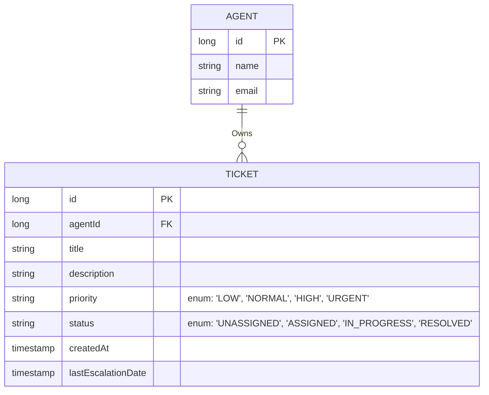

# Design

How the team split the work: the pieces, who owns each, where the pieces meet, and what the owners agreed about each
place they meet.

# Routing (Ticket Assignment / Creation)

Design (Endpoints, entities, Etc.):

    - Utitility Controller Endpoints: Assign, run sheduled job, delete ticket, update priority, update status
    - Ticket limit can exist in service layer as an environment variable (@Value), so we can update it.
    - Ticket status enum: UNASSIGNED, ASSIGNED, IN_PROGRESS, RESOLVED
    - Query Tickets for assignment, Order by Priority (URGENT -> LOW), Filter out any status that is not UNASSIGNED
    - Query Agents for assignment, Order by least # of tickets AND Longest since assigned a ticket.
    - Setup scheduled job to run every 5 minutes to assign unresolved tickets to available 

Agent Workflow Overlap:

    - Associate Agent with Ticket: One Agent to Many Tickets (List of Tickets in Agent entity)

# Escalation

Design:

    - Escalation Period should be set as an environment variable (@Value) so we can update them over time.
    - Setup schdeduled job to run every 5 minutes to check and update priority of all ASSIGNED, UNASSIGNED, and IN_PROGRESS
        tickets based on escalation period
        - Add an escalated/overdue field to ticket to mark that it has been escalated

Routing Overlap:

    - ticket priority is a required field during ticket creation

Agent WorkFlow Overlap:

    - scheduled job should only update the priority field to avoid update conflicts with an Agent updating ticket status

# Agent Workflow (status updates / viewability)

Design:

    - Ticket Controller Endpoints: Update Status, Get All, Get all Escalated, get all by status, Get by ID, Get by Agent (Optional Sort)
    - Agent Controller Endpoints: Get By ID, Create, Delete (Utility), Update (Utility)
    - Update resources/data.sql based on updated Agent entity.

Routing Overlap:

    - Ticket limit will exist in service layer as an environment variable (@Value).

| EndPoint                                  | Method | Description                             | 
|-------------------------------------------|--------|-----------------------------------------|
| /utility/tickets/:id                      | PATCH  | update ticket by Id                     |
| /utility/tickets/:id                      | DELETE | Delete a ticket by Id                   |
| /utility/agents/:agentId/ticket/:ticketId | PATCH  | assign ticket to agent                  |
| /utility/agents/:id                       | DELETE | delete an agent by Id                   |
| /utility/agents/:id                       | PATCH  | update agent by Id                      |
| /utility/ticket-assignment                | POST   | run the scheduled ticket assignment job |
| **AGENT ENDPOINTS**                       |        |                                         |
| /agents                                   | POST   | create new agent                        |
| /agents/:id                               | GET    | get agent by ID                         |
| /agents/:id/tickets                       | GET    | get all tickets assigned to an agent    |
| **TICKET ENDPOINTS**                      |        |                                         |
| /tickets/:id                              | GET    | get ticket by ID                        |
| /tickets                                  | GET    | get all tickets                         |
| /tickets/escalated                        | GET    | get all escalated tickets               |

